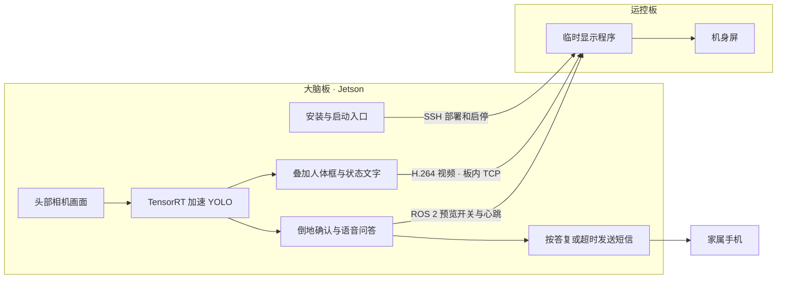

# fall-alert · T1 倒地看护

启元 T1 在双足或四足站稳时观察镜头前的人。发现有人持续横躺，机器人会问“检测到您摔倒了，是否需要通知家人？”，听取回答后决定是否发短信。一个 RPK 包含两块板的程序，使用者只在大脑板操作。

## 检测原理

1. **Jetson 的 GPU 加速人体识别。** 头部左目相机取图后，Jetson 用 NVIDIA TensorRT 执行机载 YOLO26n 人体分割模型，在机器人本地得到每个人的框和轮廓。画面覆盖整个镜头视野，地面上可以没有地垫。
2. **连续多帧确认倒地。** 程序根据人体轮廓是否横卧、位置是否重叠以及持续时间判断。默认持续 2 秒才触发，并排除明显落在床、沙发等已识别物体中的候选。沿镜头方向躺下或被家具遮挡时仍可能漏检。机器人走动或变形时暂停判断，站稳后恢复。
3. **先问本人，再通知家属。** 巡检时可以照常唤醒机器人。检测到倒地后，程序临时接管语音，问完才接收完整回答。回答“需要”会听到发送应答，家属收到的提醒包含最初的检测时间。回答“不需要”会听到“好的，我不发送通知。您先别急，能安全起身时再慢慢起来。”，本轮短信提交数为零。默认 30 秒无回应会再问一次，第二次仍无回应则播报并发送。应答播完后，机器人立即恢复原厂问答。Jetson 按事件编号记录提交状态，避免同一事件重复发信。

## 两块板怎样配合



机身屏实时显示人体框，绿色表示检测到人，红色表示确认倒地。预览会按双足或四足姿态调整方向。联系人、短信凭证和事件记录保存在 Jetson；运控板负责显示，本轮结束后交回原厂表情。

## 安装

准备一台配有 Jetson 大脑板和机载 YOLO 引擎的 T1、一份 `fall-alert-0.1.5.rpk`，以及阿里云短信账号或自有 HTTPS 短信网关。首次安装缺少 Python 包时，Jetson 需要能访问软件包源。

1. **把 RPK 传到 Jetson 并登录。** 如果还没连接过机器人，按[连接和上传步骤](docs/installation.md#连接和上传)从电脑操作。以下命令都在 Jetson 的终端执行。
2. **解包并填写短信设置。** 在新目录解包，保留旧版本的配置。

   ```bash
   cd ~
   mkdir fall-alert-0.1.5 && python3 -m zipfile -e fall-alert-0.1.5.rpk fall-alert-0.1.5
   cd ~/fall-alert-0.1.5
   chmod 600 cfg/config.yaml
   nano cfg/config.yaml
   ```

   在 `contact.phone` 填写一位家属的手机号，在 `sms` 下填写阿里云签名、模板和凭证，或选择自己的 HTTPS 短信网关。保留缩进和号码两边的引号。按 **Ctrl+O、回车、Ctrl+X** 保存退出。[短信字段说明](docs/configuration.md)

3. **从 Jetson 安装两块板的程序。**

   ```bash
   python3 main.py install
   ```

   看到“两块板安装完成”表示 Jetson 的 Python 环境已就绪，运控板已收到显示程序。重复安装会保留配置。如果手边还没有短信凭证，可以先用空白模板安装，准备好后再填写配置。安装过程不会发送短信。

## 使用方法

让 T1 在看护位置双足或四足站稳，使镜头能看见需要照看的区域。在 Jetson 上启动：

```bash
cd ~/fall-alert-0.1.5
python3 main.py start
```

保持终端打开。看到 `Running as unit` 后，程序会持续等待倒地事件。听完提问后说“需要”或“不需要”。一轮处理完毕，屏幕恢复表情，终端返回；下次看护再运行 `start`。

| 想做什么 | 在 Jetson 技能目录执行 |
| --- | --- |
| 查看两块板的运行状态 | `python3 main.py status` |
| 提前结束并恢复表情 | `python3 main.py stop`，或在启动终端按 Ctrl+C |
| 查看检测、问答和短信进度 | 在第二个终端运行 `journalctl -fu t1-fall-skill-watch.service -o cat` |

[安装、升级与故障处理](docs/installation.md) · [短信配置与发送规则](docs/configuration.md)
